# Class Activity 1 — System Calls in Practice

- **Student Name:** Phoung Sovannara
- **Student ID:** e20230093
- **Date:** 2026-10-26

---

## Warm-Up: Hello System Call

Screenshot of running `hello_syscall.c` on Linux:

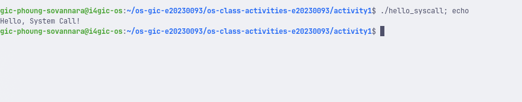

Screenshot of running `hello_winapi.c` on Windows (CMD/PowerShell/VS Code):

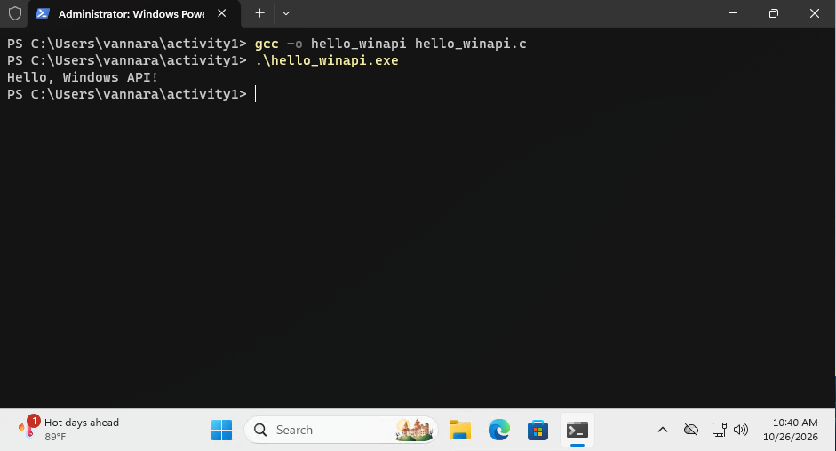

Screenshot of running `copyfilesyscall.c` on Linux:

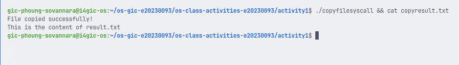

---

## Task 1: File Creator & Reader

### Part A — File Creator

**Describe your implementation:** The library version only needs `fopen`, `fprintf`, `fclose` and `printf`. In the system call version I had to do everything myself: open the file with `open()` and choose the flags and the permissions, write the text with `write()` and give its exact length with `strlen()`, close the file descriptor with `close()`, and print the confirmation with `write(1, ...)` because fd 1 is stdout. Both versions print the same message and create the same `output.txt`.

**Version A — Library Functions (`file_creator_lib.c`):**

<!-- Screenshot: gcc -o file_creator_lib file_creator_lib.c && ./file_creator_lib && cat output.txt -->
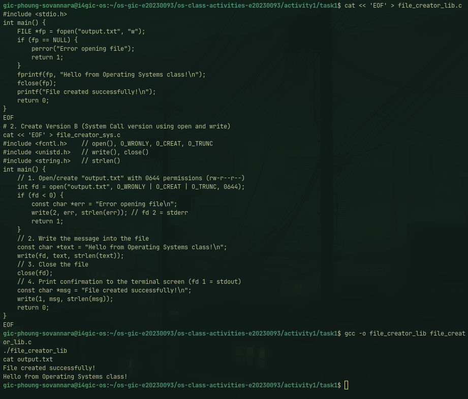

**Version B — POSIX System Calls (`file_creator_sys.c`):**

<!-- Screenshot: gcc -o file_creator_sys file_creator_sys.c && ./file_creator_sys && cat output.txt -->
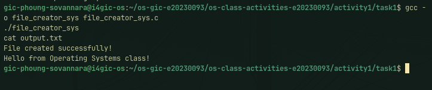

**Questions:**

1. **What flags did you pass to `open()`? What does each flag mean?**

   > I used `O_WRONLY | O_CREAT | O_TRUNC`.
   > - `O_WRONLY`: open the file for writing only.
   > - `O_CREAT`: create the file if it does not exist yet. With this flag, `open()` needs a third argument for the permissions.
   > - `O_TRUNC`: if the file already exists, empty it first (length 0), so the old content is erased.

2. **What is `0644`? What does each digit represent?**

   > It is the file permission in octal (the leading `0` means octal in C). Each digit is read (4) + write (2) + execute (1):
   > - `6` = owner: read + write (`rw-`)
   > - `4` = group: read only (`r--`)
   > - `4` = others: read only (`r--`)
   >
   > So the file is `-rw-r--r--`.

3. **What does `fopen("output.txt", "w")` do internally that you had to do manually?**

   > `fopen()` translates `"w"` into the flags `O_WRONLY | O_CREAT | O_TRUNC` and calls `openat()` for me with mode `0666` (then the umask removes some bits). It also allocates a `FILE` structure and a buffer in user memory, so `fprintf()` writes into that buffer and the real `write()` happens later. I saw this in strace: the library version opens with `0666`, while my version opens with the `0644` I chose.

### Part B — File Reader & Display

**Describe your implementation:** The library version reads line by line with `fgets()` and prints with `printf()`. In my system call version I open the file with `open(..., O_RDONLY)`, then call `read()` in a `while` loop with a 256-byte buffer and send each chunk to the terminal with `write(1, buffer, bytesRead)`. I only write `bytesRead` bytes, not the whole buffer, because the buffer is not a string and the last chunk can be smaller.

**Version A — Library Functions (`file_reader_lib.c`):**

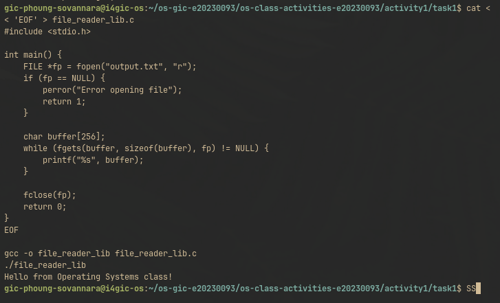

**Version B — POSIX System Calls (`file_reader_sys.c`):**

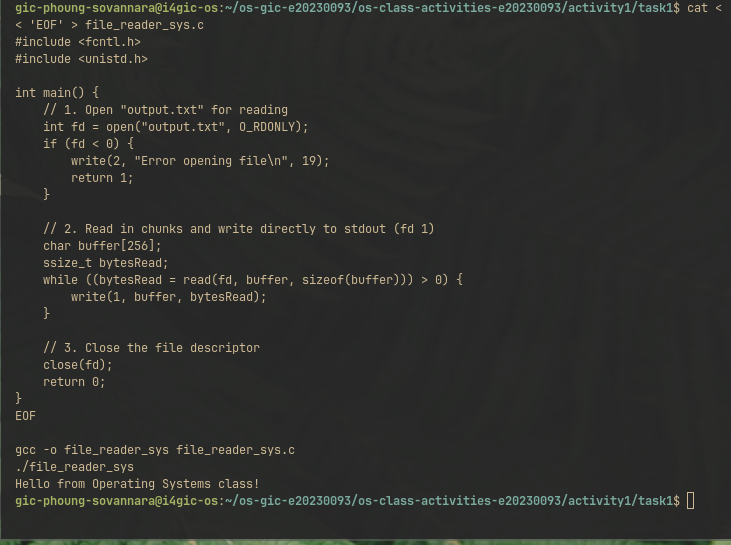

**Questions:**

1. **What does `read()` return? How is this different from `fgets()`?**

   > `read()` returns a number (`ssize_t`): how many bytes it put in the buffer. It returns `0` at end of file and `-1` on error. It does not stop at a newline and does not add `'\0'`, it just copies raw bytes.
   >
   > `fgets()` returns a pointer to the buffer (or `NULL` at end of file or on error). It stops after one line (at `'\n'`) or when the buffer is full, and it always adds `'\0'`, so the result is a C string.

2. **Why do you need a loop when using `read()`? When does it stop?**

   > One `read()` only reads up to the buffer size (256 bytes in my program). A bigger file needs many calls, so the loop keeps reading until the whole file is done. It stops when `read()` returns `0` (end of file), or `-1` if there is an error.

---

## Task 2: Directory Listing & File Info

**Describe your implementation:** I still use `opendir()`, `readdir()` and `stat()` to go through the directory and get each file size. The difference is the output: instead of `printf()`, I format each line into a buffer with `snprintf(buffer, sizeof(buffer), "%-30s %10ld\n", ...)` and then print it with `write(1, buffer, len)`. The header is also printed with `write()`. Both versions show the same table.

### Version A — Library Functions (`dir_list_lib.c`)

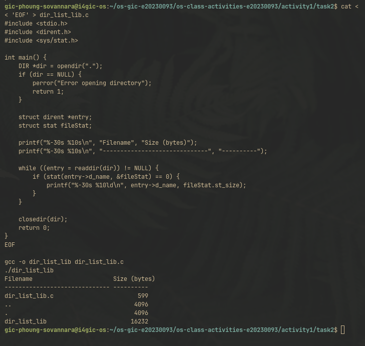

### Version B — System Calls (`dir_list_sys.c`)

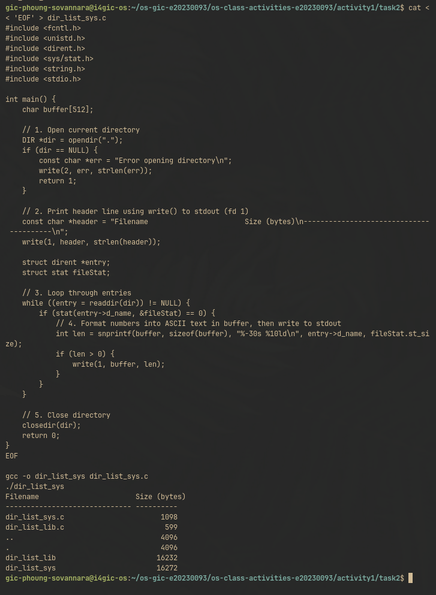

### Questions

1. **What struct does `readdir()` return? What fields does it contain?**

   > It returns a pointer to `struct dirent` (or `NULL` when there are no more entries). The main fields are:
   > - `d_ino`: inode number of the entry
   > - `d_off`: position of the next entry in the directory
   > - `d_reclen`: length of this record
   > - `d_type`: type of the entry (`DT_REG` regular file, `DT_DIR` directory, ...)
   > - `d_name`: the file name as a string

2. **What information does `stat()` provide beyond file size?**

   > The file type and permissions (`st_mode`), inode number (`st_ino`), device (`st_dev`), number of hard links (`st_nlink`), owner and group (`st_uid`, `st_gid`), the times of last access, modification and status change (`st_atime`, `st_mtime`, `st_ctime`), the block size for I/O (`st_blksize`) and the number of 512-byte blocks used (`st_blocks`).

3. **Why can't you `write()` a number directly — why do you need `snprintf()` first?**

   > `write()` only copies raw bytes from memory. A `long` like `1098` is stored as binary bytes, not as the characters `'1' '0' '9' '8'`, so writing it directly would print unreadable bytes. `snprintf()` converts the number into ASCII text inside a buffer, and it returns the length that I pass to `write()`.

---

## Task 3: strace Analysis

**Describe what you observed:** Both versions start the same way: the dynamic loader opens `/etc/ld.so.cache` and `libc.so.6`, because both programs are linked with libc. The difference is in the file I/O. In the reader, `fgets()` asked the kernel for **4096** bytes at once (the stdio buffer), while my version asked for exactly **256** bytes, the size of my own buffer. In the creator, `fprintf()` did not write anything when I called it: there is only **one** `write()` to the file, and it comes when `fclose()` flushes the buffer. With `strace -c`, the library version made **38** system calls and my system call version made **34**. Most of the calls are program startup, so the difference is small for such a tiny file.

### strace Output — Library Version (File Creator)

<!-- Screenshot: strace -e trace=openat,read,write,close ./file_creator_lib -->
<!-- IMPORTANT: Highlight/annotate the key system calls in your screenshot -->
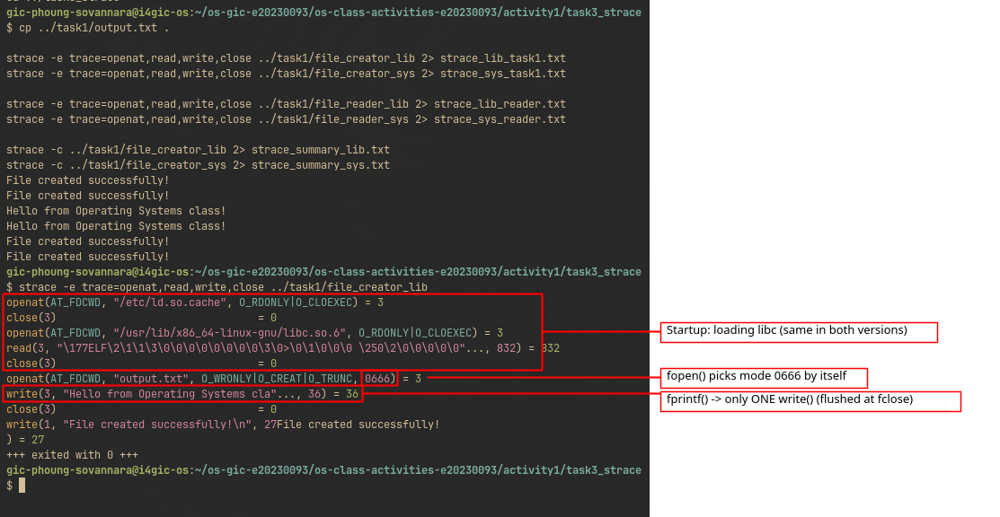

### strace Output — System Call Version (File Creator)

<!-- Screenshot: strace -e trace=openat,read,write,close ./file_creator_sys -->
<!-- IMPORTANT: Highlight/annotate the key system calls in your screenshot -->
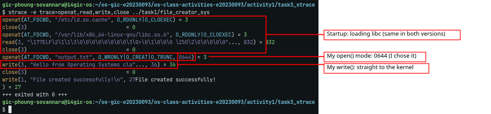

### strace Output — Library Version (File Reader or Dir Listing)

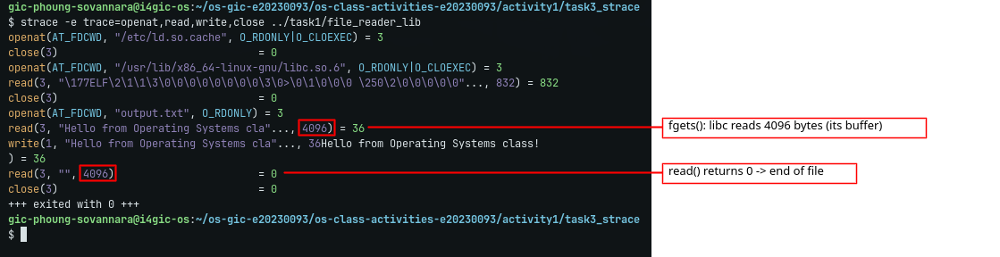

### strace Output — System Call Version (File Reader or Dir Listing)

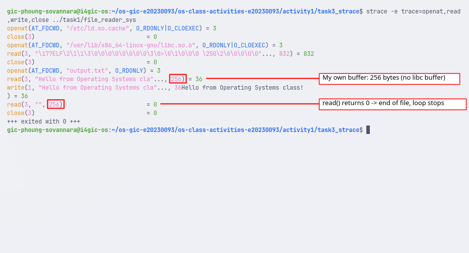

### strace -c Summary Comparison

<!-- Screenshot of `strace -c` output for both versions -->
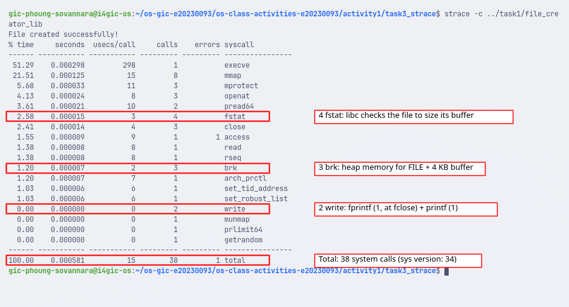
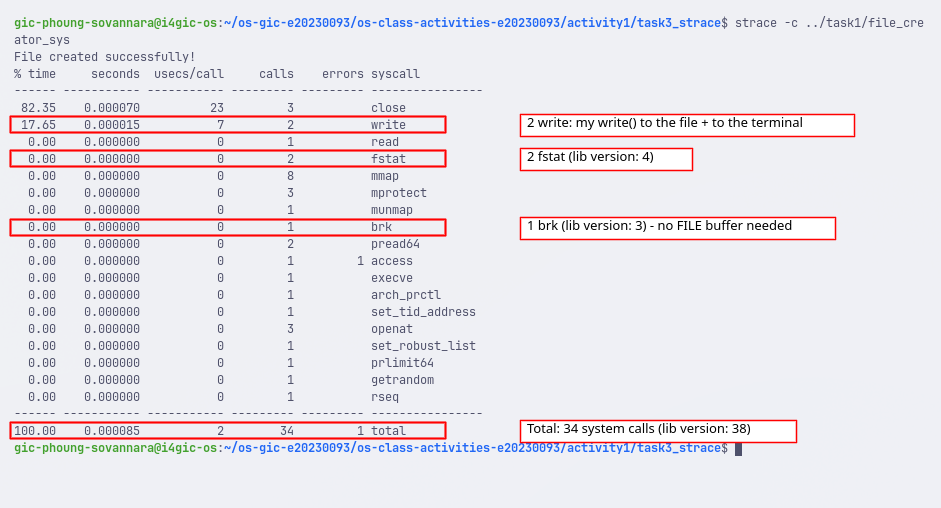

### Questions

1. **How many system calls does the library version make compared to the system call version?**

   > From `strace -c` on the file creator: the library version makes **38** system calls and the system call version makes **34**, so 4 more. The difference is 2 extra `brk` (3 vs 1) and 2 extra `fstat` (4 vs 2). All the other calls are the same in both.

2. **What extra system calls appear in the library version? What do they do?**

   > - `brk` (3 instead of 1): grows the heap. `fopen()` needs heap memory for the `FILE` structure and its I/O buffer.
   > - `fstat` (4 instead of 2): asks the kernel for information about a file descriptor. stdio uses it to choose the buffer size for the file and for stdout.
   > - `openat` with mode `0666`: `fopen()` chooses the permissions by itself.
   >
   > Calls like `mmap`, `mprotect`, `pread64` and the `openat` of `libc.so.6` appear in **both** versions: they come from loading the program and libc at startup, not from my code.

3. **How many `write()` calls does `fprintf()` actually produce?**

   > Only **one**. `fprintf()` puts the text in the user-space buffer and returns. The buffer is sent to the kernel in a single `write(3, "Hello from Operating Systems class!\n", 36)` when `fclose()` is called. The second `write()` in the summary is the `printf()` of "File created successfully!" to the terminal. So I expected a write at the `fprintf()` line, but the buffering moves it to `fclose()`.

4. **In your own words, what is the real difference between a library function and a system call?**

   > A library function like `fprintf()` or `fgets()` is normal code that runs in user mode inside my process. It makes things easier (formatting, lines, buffering) and it calls the kernel only when it really needs to. A system call like `write()` or `read()` is the only way to ask the kernel to do something: the CPU switches from user mode to kernel mode, the kernel does the work (for example on the disk), and then it returns. strace shows only these system calls, which is why `fprintf()` itself never appears in the trace, only the `write()` it causes later.

---

## Task 4: Exploring OS Structure

### System Information

> 📸 Screenshot of `uname -a`, `/proc/cpuinfo`, `/proc/meminfo`, `/proc/version`, `/proc/uptime`:

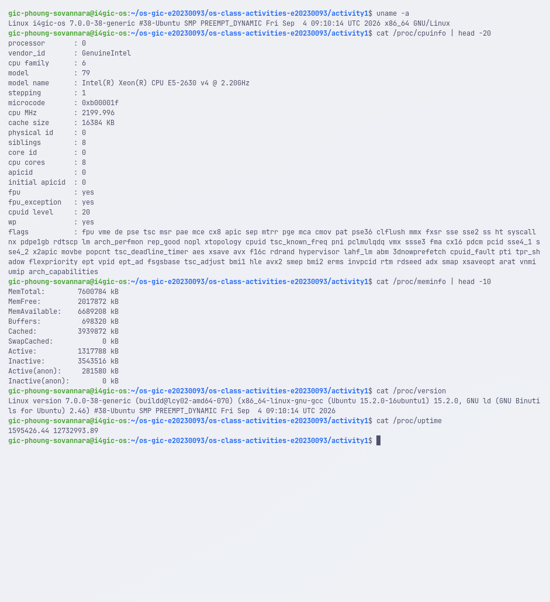

### Process Information

> 📸 Screenshot of `/proc/self/status`, `/proc/self/maps`, `ps aux`:

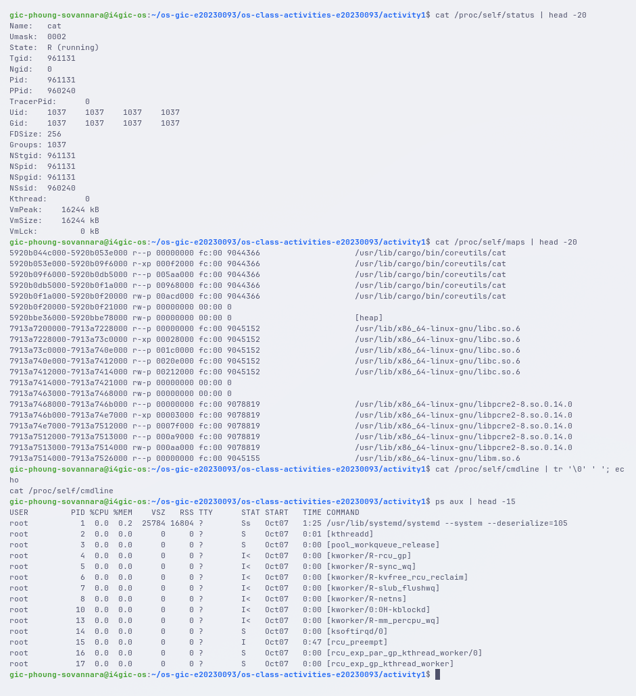

### Kernel Modules

> 📸 Screenshot of `lsmod` and `modinfo`:

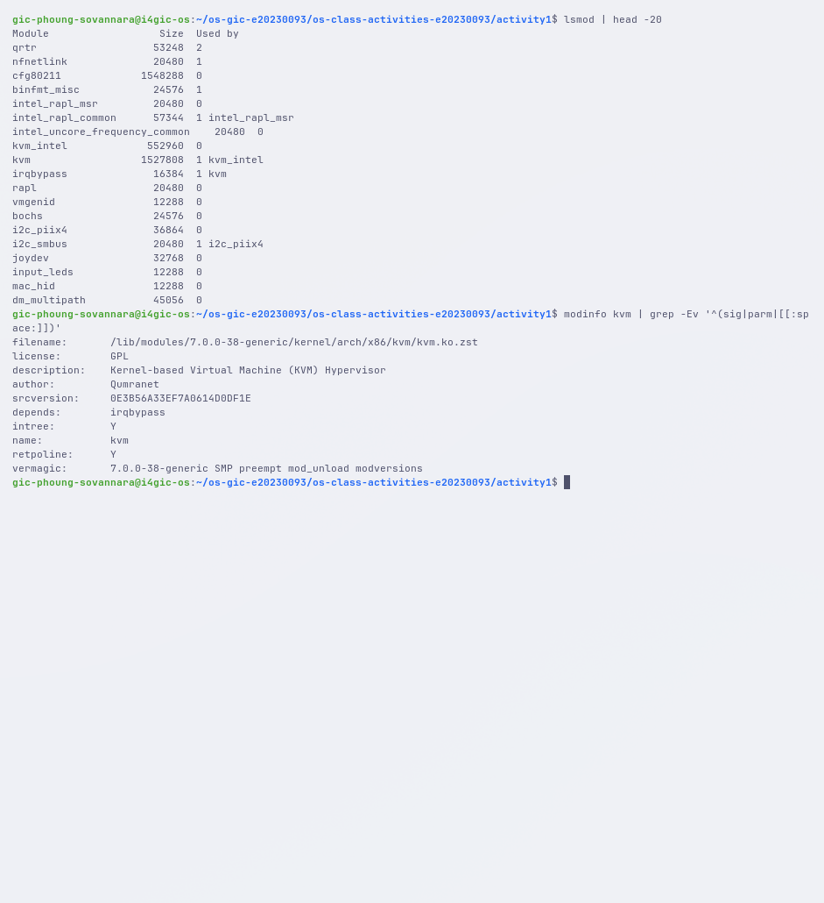

### OS Layers Diagram

> 📸 Your diagram of the OS layers, labeled with real data from your system:

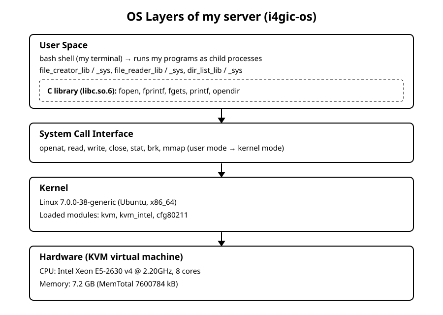

### Questions

1. **What is `/proc`? Is it a real filesystem on disk?**

   > `/proc` is a virtual filesystem. It is not stored on the disk: the kernel creates the content of each file at the moment I read it, from its own data in memory. For example `/proc/meminfo` shows the current memory usage, and `/proc/uptime` changes every time I read it.

2. **Monolithic kernel vs. microkernel — which type does Linux use?**

   > Linux is a monolithic kernel: the scheduler, memory management, file systems and drivers all run together in kernel space. But it is modular: parts can be loaded and unloaded while the system runs. `lsmod` showed modules like `kvm`, `kvm_intel` and `cfg80211`, and `modinfo kvm` showed that it is a file (`kvm.ko.zst`) that depends on another module, `irqbypass`.

3. **What memory regions do you see in `/proc/self/maps`?**

   > For the `cat` process I saw:
   > - the program itself (`/usr/lib/cargo/bin/coreutils/cat`) in several parts: read-only (`r--p`), executable code (`r-xp`) and writable data (`rw-p`)
   > - the `[heap]`
   > - shared libraries: `libc.so.6`, `libpcre2-8.so` and `libm.so.6`, also split into code, read-only and data parts
   > - anonymous regions (no file name) for memory the program allocated
   >
   > Further down the file there are also the `[stack]` and `[vdso]`, but they are not in the first 20 lines.

4. **Break down the kernel version string from `uname -a`.**

   > `Linux i4gic-os 7.0.0-38-generic #38-Ubuntu SMP PREEMPT_DYNAMIC Fri Sep 4 09:10:14 UTC 2026 x86_64 GNU/Linux`
   > - `Linux`: kernel name
   > - `i4gic-os`: hostname of the server
   > - `7.0.0`: kernel version (major 7, minor 0, patch 0)
   > - `-38`: Ubuntu's build/ABI number for this kernel
   > - `generic`: the kernel flavour (the general-purpose Ubuntu kernel)
   > - `#38-Ubuntu`: the build number from Ubuntu
   > - `SMP`: supports several CPUs
   > - `PREEMPT_DYNAMIC`: the preemption mode can be chosen at boot
   > - `Fri Sep 4 09:10:14 UTC 2026`: when the kernel was built
   > - `x86_64`: 64-bit Intel/AMD architecture
   > - `GNU/Linux`: the operating system (Linux kernel + GNU tools)

5. **How does `/proc` show that the OS is an intermediary between programs and hardware?**

   > Programs never read the hardware directly. To get the CPU model (Intel Xeon E5-2630 v4) or the memory size (7600784 kB), I just read a file with `cat`, which uses normal `open()` and `read()` system calls. The kernel answers by generating the text from what it knows about the hardware. The same happens for processes: `ps aux` gets its list by reading `/proc/<PID>/` folders. So the kernel sits in the middle and gives programs a simple file interface to the hardware and to its own state.

---

## Reflection

Before this activity I thought `fprintf()` and `write()` were almost the same thing. strace showed me that they are not: `fprintf()` did not reach the kernel at all until `fclose()`, and `fgets()` read 4096 bytes even though my file was only 36 bytes. The library adds buffering to save system calls, which is good for big files but hides what really happens. Writing the system call versions made me handle things the library normally does for me, like the open flags, the permissions, the length of each write and the `read()` loop.

The most surprising part was that only about 4 of the 34 system calls in my version (`openat`, two `write` and `close`) come from my own code. All the others are the loader setting up the program and libc. I also found it interesting that `/proc` is not a real folder on the disk but the kernel answering my `read()` calls.
