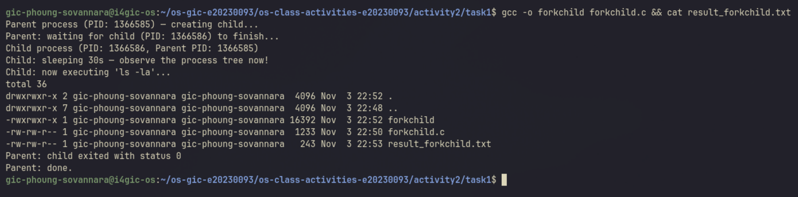
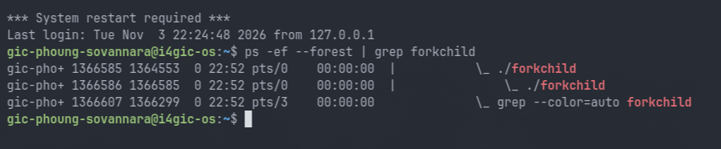
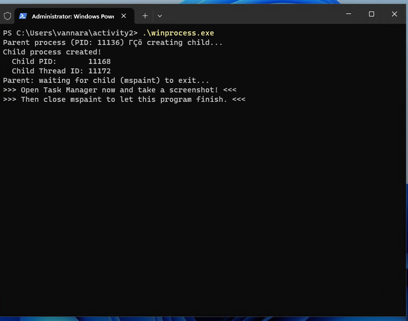
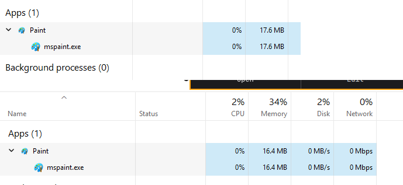
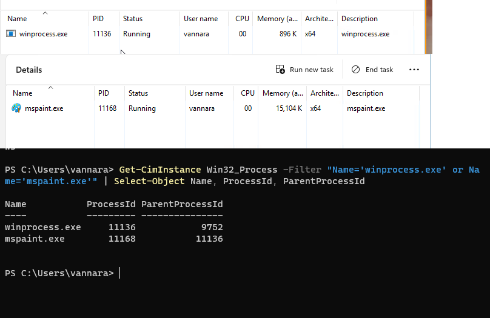
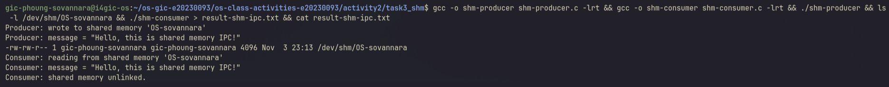
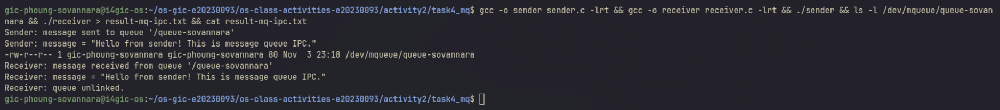

# Class Activity 2 — Processes & Inter-Process Communication

- **Student Name:** Phoung Sovannara
- **Student ID:** e20230093
- **Date:** 2026-11-12

---

## Task 1: Process Creation on Linux (fork + exec)

### Compilation & Execution

Screenshot of compiling and running `forkchild.c`:



### Process Tree

Screenshot of the parent-child process tree (using `ps --forest`, `pstree`, or `htop` tree view):



### Output

```
Parent process (PID: 1366585) — creating child...
Parent: waiting for child (PID: 1366586) to finish...
Child process (PID: 1366586, Parent PID: 1366585)
Child: sleeping 30s — observe the process tree now!
Child: now executing 'ls -la'...
total 36
drwxrwxr-x 2 gic-phoung-sovannara gic-phoung-sovannara  4096 Nov  3 22:52 .
drwxrwxr-x 7 gic-phoung-sovannara gic-phoung-sovannara  4096 Nov  3 22:48 ..
-rwxrwxr-x 1 gic-phoung-sovannara gic-phoung-sovannara 16392 Nov  3 22:52 forkchild
-rw-rw-r-- 1 gic-phoung-sovannara gic-phoung-sovannara  1233 Nov  3 22:50 forkchild.c
-rw-rw-r-- 1 gic-phoung-sovannara gic-phoung-sovannara   243 Nov  3 22:53 result_forkchild.txt
Parent: child exited with status 0
Parent: done.
```

Note: I ran the program as `stdbuf -oL ./forkchild > result_forkchild.txt 2>&1`. When stdout goes to a file, `printf` keeps the text in a buffer, and `execlp()` replaces the child's memory before that buffer is written, so the child's lines were lost. `stdbuf -oL` makes stdout line-buffered, so every line is written immediately.

### Questions

1. **What does `fork()` return to the parent? What does it return to the child?**

   > `fork()` returns twice. In the parent it returns the PID of the new child (here 1366586). In the child it returns `0`. If it fails, it returns `-1` in the parent and no child is created. That is how the same code can take different branches: `pid == 0` is the child, `pid > 0` is the parent.

2. **What happens if you remove the `waitpid()` call? Why might the output look different?**

   > The parent would not wait: it would print its last lines and exit right away, while the child is still sleeping. The shell prompt would come back, and the child's output (`ls -la`) would appear 30 seconds later, mixed into the terminal after the prompt. The child becomes an orphan and is adopted by another process (systemd), which collects its exit status. Without `waitpid()` the parent also cannot read the child's exit status.

3. **What does `execlp()` do? Why don't we see "execlp failed" when it succeeds?**

   > `execlp()` replaces the program running in the current process with a new program, here `ls`, found by searching the `PATH`. The PID stays the same (1366586), but the code, data and stack are replaced by `ls`. If it succeeds, it never returns, because the old code that called it no longer exists, so the `perror("execlp")` line after it is never reached. It only runs if `execlp()` fails and returns `-1`.

4. **Draw the process tree for your program (parent → child). Include PIDs from your output.**

   > ```
   > bash (PID 1364553)
   >  └── ./forkchild  parent (PID 1366585, PPID 1364553)
   >       └── ./forkchild  child (PID 1366586, PPID 1366585)
   >                         └── after execlp(): becomes "ls -la" (same PID 1366586)
   > ```

5. **Which command did you use to view the process tree (`ps --forest`, `pstree`, or `htop`)? What information does each column show?**

   > I used `ps -ef --forest | grep forkchild`. The columns are: `UID` (owner of the process), `PID` (process ID), `PPID` (parent process ID), `C` (CPU usage), `STIME` (start time), `TTY` (terminal it runs on), `TIME` (CPU time used) and `CMD` (the command). `--forest` draws the tree with `\_`, so the child is indented under the parent, and its PPID (1366585) is the parent's PID.

---

## Task 2: Process Creation on Windows

### Compilation & Execution

Screenshot of compiling and running `winprocess.c`:



Note: on my Windows 11 VM, Paint is a Microsoft Store app and is not in `C:\Windows\System32`, so the original path gave `CreateProcess failed (error 2)` (file not found). I found the real path with `where.exe mspaint` and changed the path in `winprocess.c` to `C:\Users\vannara\AppData\Local\Microsoft\WindowsApps\mspaint.exe`.

### Task Manager Screenshots

Screenshot showing process tree in the **Processes** tab (mspaint nested under your program):



Screenshot showing PID and Parent PID in the **Details** tab:



Note: the Task Manager on my Windows 11 version has no "Parent PID" column in the Details tab (I checked the whole Select columns list). The Details tab shows the PIDs, and I read the parent PID with PowerShell: `Get-CimInstance Win32_Process -Filter "Name='winprocess.exe' or Name='mspaint.exe'" | Select-Object Name, ProcessId, ParentProcessId`.

### Questions

1. **What is the key difference between how Linux creates a process (`fork` + `exec`) and how Windows does it (`CreateProcess`)?**

   > Linux uses two steps: `fork()` makes a copy of the parent process, then `exec()` replaces that copy with the new program. Between the two, the child can still change things (for example redirect files) before the new program starts. Windows does everything in one call: `CreateProcess()` creates a new, empty process and loads the given program into it directly, with all the settings passed as parameters. There is no copy of the parent.

2. **What does `WaitForSingleObject()` do? What is its Linux equivalent?**

   > It blocks the calling thread until the object behind the handle is signaled. For a process handle, that happens when the process ends, so the parent waits until mspaint is closed. `INFINITE` means no time limit. The Linux equivalent is `waitpid()` (or `wait()`).

3. **Why do we need to call `CloseHandle()` at the end? What happens if we don't?**

   > `CreateProcess()` gives the parent two handles, one for the child process and one for its main thread. They are references to kernel objects, and the kernel keeps an object until every handle to it is closed. `CloseHandle()` releases them. Without it the handles leak: the kernel keeps the child's process information even after it has exited, until the parent itself exits. In a long-running program that creates many processes, this wastes kernel resources.

4. **In Task Manager, what was the PID of your parent program and the PID of mspaint? Do they match your program's output?**

   > `winprocess.exe` had PID 11136 and `mspaint.exe` had PID 11168. They match the output exactly: `Parent process (PID: 11136)` and `Child PID: 11168`. PowerShell also showed that the parent PID of `mspaint.exe` is 11136, and the parent of `winprocess.exe` is 9752, the PowerShell that started it.

5. **Compare the Processes tab (tree view) and the Details tab (PID/PPID columns). Which view makes it easier to understand the parent-child relationship? Why?**

   > The PID/PPID information is clearer. In my case the Processes tab did not show Paint under `winprocess.exe` at all: `winprocess.exe` was under "Background processes" and Paint was under "Apps", because the Processes tab groups by application (and Paint is a Store app), not by real parent. Only the PIDs and the parent PID showed the real relationship: `mspaint.exe` (11168) has parent 11136, which is `winprocess.exe`. The tree view is easier to read at a glance, but the PID/PPID numbers are what actually prove it.

---

## Task 3: Shared Memory IPC

### Compilation & Execution

Screenshot of compiling and running `shm-producer` and `shm-consumer`:



### Output

```
Consumer: reading from shared memory 'OS-sovannara'
Consumer: message = "Hello, this is shared memory IPC!"
Consumer: shared memory unlinked.
```

### Questions

1. **What does `shm_open()` do? How is it different from `open()`?**

   > `shm_open()` creates or opens a POSIX shared memory object by name and returns a file descriptor for it. Unlike `open()`, the object is not a file on disk: it lives in memory (on Linux it appears in `/dev/shm`, mine was `/dev/shm/OS-sovannara`) and disappears at reboot. It is meant to be mapped into memory with `mmap()`, not read with `read()`. A new object has size 0, so the producer sets its size with `ftruncate()`.

2. **What does `mmap()` do? Why is shared memory faster than other IPC methods?**

   > `mmap()` maps the shared memory object into the process's address space and returns a pointer, so the program can use it like a normal array. With `MAP_SHARED`, the producer and the consumer map the same physical memory. It is fast because after the setup there are no system calls and no copying: the producer writes with `sprintf()` and the consumer reads the same bytes directly. Pipes and message queues copy the data into the kernel and back out again on every message.

3. **Why must the shared memory name match between producer and consumer?**

   > The name is how the two separate processes find the same object. The producer creates `OS-sovannara`, and the consumer opens it by the same name. With a different name the consumer would look for an object that does not exist and get "No such file or directory". The name also has to be unique on the shared server, so I do not open another student's memory.

4. **What does `shm_unlink()` do? What would happen if the consumer didn't call it?**

   > `shm_unlink()` removes the name of the shared memory object, so it is deleted once no process has it mapped. Without it, the object would stay in `/dev/shm` and keep using memory after both programs have exited, until someone unlinks it or the system reboots. I saw it exist between the two programs: `/dev/shm/OS-sovannara` (4096 bytes) was still there after the producer had exited.

5. **If the consumer runs before the producer, what happens? Try it and describe the error.**

   > I tried it, and the consumer failed:
   > ```
   > shm_open: No such file or directory
   > Hint: Did you run shm-producer first?
   > ```
   > The consumer opens the object with `O_RDONLY` and without `O_CREAT`, so it can only open an object that already exists. Since the producer had not created `OS-sovannara` yet, `shm_open()` returned `-1` with the error `ENOENT`, and the program stopped before reading.

---

## Task 4: Message Queue IPC

### Compilation & Execution

Screenshot of compiling and running `sender` and `receiver`:



### Output

```
Receiver: message received from queue '/queue-sovannara'
Receiver: message = "Hello from sender! This is message queue IPC."
Receiver: queue unlinked.
```

### Questions

1. **How is a message queue different from shared memory? When would you use one over the other?**

   > With shared memory both processes access the same memory directly, so it is the fastest, but the programs must synchronize themselves (for example with a semaphore) so one does not read while the other is writing. A message queue is managed by the kernel: the sender copies a whole message in with `mq_send()`, the receiver takes it out with `mq_receive()`, messages stay separate and in order, and the receiver can block until a message arrives. I would use shared memory for large data or high speed, and a message queue for small messages or commands where simple, safe communication matters more than speed.

2. **Why does the queue name in `common.h` need to start with `/`?**

   > POSIX requires a message queue name to start with one slash, followed by a name with no other slashes. It is not a path on disk. On Linux the queue appears as a file in the special `/dev/mqueue` filesystem (mine was `/dev/mqueue/queue-sovannara`). A name without the leading `/` makes `mq_open()` fail with `EINVAL`.

3. **What does `mq_unlink()` do? What happens if neither the sender nor receiver calls it?**

   > `mq_unlink()` removes the queue's name, and the queue is destroyed once every process has closed it. If nobody calls it, the queue stays in the kernel after both programs exit, together with any messages still in it, until it is unlinked or the system reboots. The next time the sender runs, it would open the old queue and add to it.

4. **What happens if you run the receiver before the sender?**

   > I tried it, and the receiver failed:
   > ```
   > mq_open: No such file or directory
   > Hint: Did you run sender first?
   > ```
   > The receiver opens the queue with `O_RDONLY` and no `O_CREAT`, so it cannot create it, and the queue did not exist yet. If the queue already existed but was empty, the receiver would not fail: `mq_receive()` would block and wait until a message arrives, because the queue is in blocking mode.

5. **Can multiple senders send to the same queue? Can multiple receivers read from the same queue?**

   > Yes to both. Any number of processes can open the same queue by name and send to it, and the kernel keeps the messages in order (by priority, then arrival). Several receivers can also read from it, but each message is delivered to only one receiver: once one process receives it, it is removed from the queue, so the others do not get a copy.

---

## Reflection

The most interesting part for me was the difference between Linux and Windows process creation. On Linux, `fork()` first makes a copy of the program and `exec()` then turns that copy into `ls`, and I could watch it in `ps --forest`: same PID, new program. On Windows, `CreateProcess()` started Paint in one call. I also learned that the tools do not always show what really happens: Task Manager did not show Paint under my program, and only the parent PID proved the relationship. For IPC, I prefer message queues for normal use, because the kernel handles the order and the waiting, and the receiver simply blocks until a message arrives. Shared memory is faster, but with more than one message the programs would need their own synchronization. Finally, the output buffering problem in Task 1 showed me that `printf` writes into a user-space buffer first, and `exec()` throws that buffer away.
