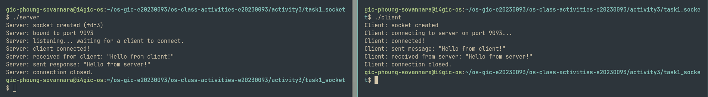
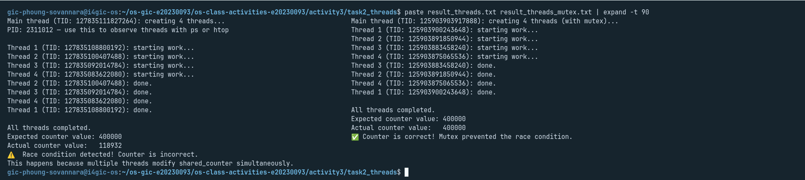
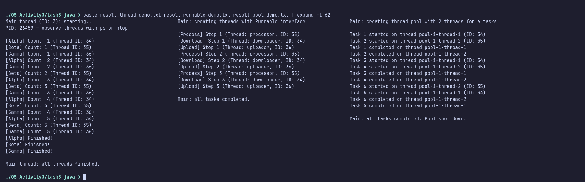
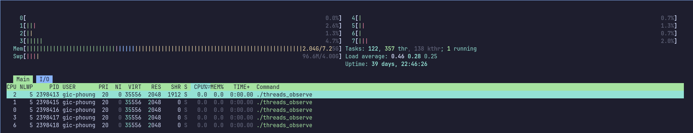
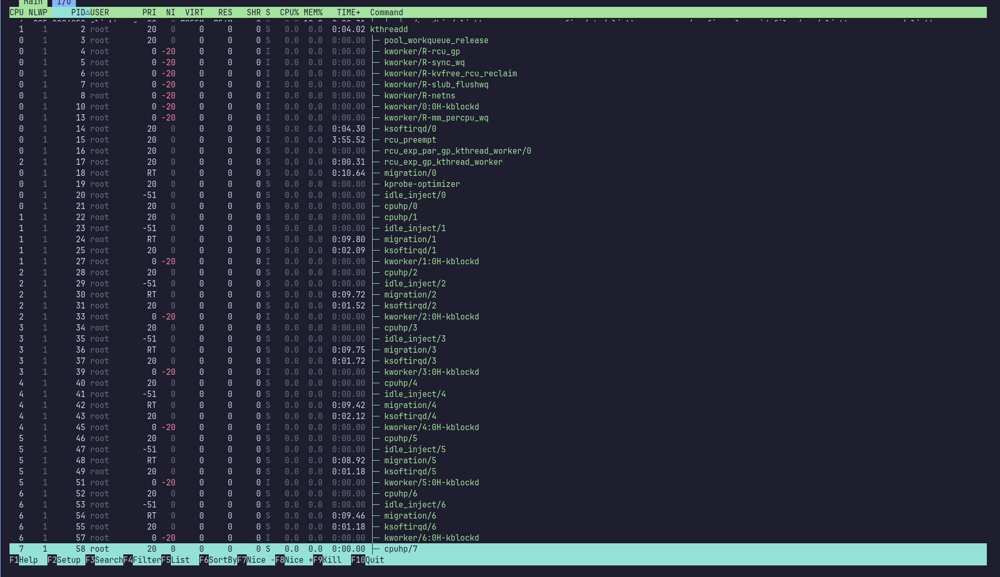
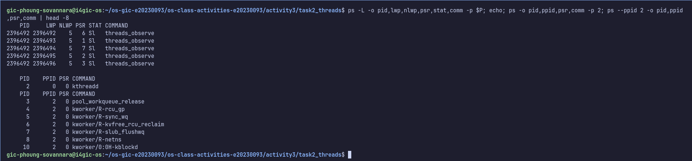
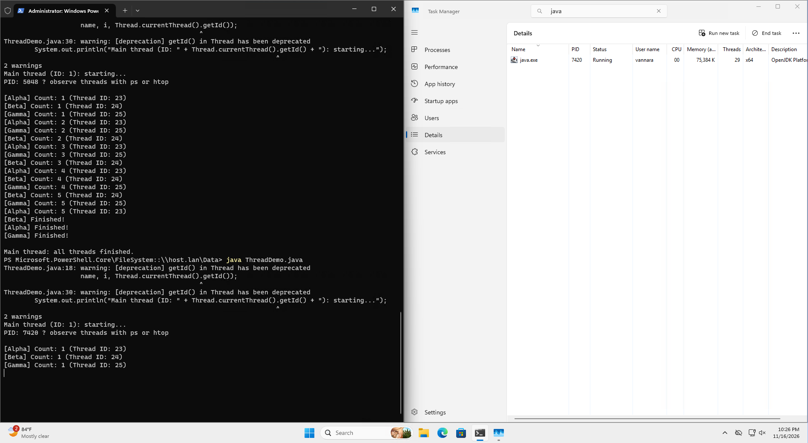

# Class Activity 3 — Socket Communication & Multithreading

- **Student Name:** Phoung Sovannara
- **Student ID:** e20230093
- **Date:** 2026-11-16

---

## Task 1: TCP Socket Communication (C)

### Compilation & Execution



Note: I changed `PORT` from 8080 to 9093 in both `server.c` and `client.c`, because the course server is shared and another student could already be using port 8080.

### Answers

1. **Role of `bind()` / Why client doesn't call it:**
   > `bind()` gives the server socket a fixed address: an IP (here `INADDR_ANY`, all interfaces) and a port (9093). Clients need to know this address to find the server, so it must be fixed. The client does not call `bind()` because it does not need a known port: when it calls `connect()`, the kernel automatically gives it a free temporary (ephemeral) port.

2. **What `accept()` returns:**
   > `accept()` waits until a client connects and then returns a **new** file descriptor for that one connection (`client_fd`). The original `server_fd` is only the listening socket: it never carries data, it just keeps waiting for new connections. All `read()` and `send()` for the client happen on `client_fd`, so a server can accept many clients, each with its own descriptor.

3. **Starting client before server:**
   > I tried it and got:
   > ```
   > Client: socket created
   > Client: connecting to server on port 9093...
   > connect: Connection refused
   > ```
   > No program was listening on port 9093, so the kernel rejected the connection and `connect()` returned -1 with `ECONNREFUSED`.

4. **What `htons()` does:**
   > `htons()` means "host to network short". It converts a 16-bit number (the port) from the computer's byte order to network byte order, which is big-endian. x86 CPUs store numbers little-endian, so without the conversion the bytes of the port would be swapped and the program would use a different port. All computers on a network agree on big-endian, so it works between different machines.

5. **Socket call sequence diagram:**
   > ```
   >      SERVER                          CLIENT
   >   socket()                        socket()
   >   bind(9093)                          |
   >   listen()                            |
   >   accept()  ... blocks ...            |
   >      |  <------- connection ------  connect(127.0.0.1:9093)
   >   read()    <---- "Hello from client!" ---- send()
   >   send()    ---- "Hello from server!" ----> read()
   >   close()                         close()
   > ```

---

## Task 2: POSIX Threads (C)

### Output — Without Mutex (Race Condition)



### Output — With Mutex (Correct)

Left side of the screenshot: without the mutex the counter was **118932** instead of 400000 (other runs: 158008, 123224, 121768). Right side: with the mutex it was **400000**.

### Answers

1. **What is a race condition?**
   > A race condition happens when several threads use the same data at the same time and the result depends on the timing. `shared_counter++` looks like one step, but the CPU does three: read the value, add 1, write it back. When two threads read the same value (for example 500) before either writes, both write 501, and one increment is lost. With 4 threads on 8 cores this happened all the time: about 70% of the increments were lost, and the result was different on every run.

2. **What does `pthread_mutex_lock()` do?**
   > It locks the mutex. If another thread already holds it, the calling thread waits (sleeps) until it is unlocked. I put `shared_counter++` between `pthread_mutex_lock()` and `pthread_mutex_unlock()`, so only one thread at a time can do the read-add-write. No update can be lost any more, and the result was exactly 400000. The cost is speed: the threads take turns instead of running fully in parallel.

3. **Removing `pthread_join()`:**
   > Without `pthread_join()`, `main()` does not wait for the threads. It prints the counter right away, while the threads have barely started, so the value is far too small (often 0). Then `main()` returns, which ends the whole process, and the worker threads are killed in the middle of their work. Their "done" lines may never be printed.

4. **Thread vs Process:**
   > A process is a running program with its own address space. A thread is a path of execution inside a process; one process can have many threads. Threads of the same process **share** the code, global variables (like `shared_counter`), the heap and open files. Each thread has its **own** stack (local variables), registers, program counter and thread ID. That is why threads can share data easily (but need locks), while separate processes need IPC to share anything.

---

## Task 3: Java Multithreading

Java is not installed on the course server, so I compiled and ran the three programs on my own Linux laptop (OpenJDK 25) and copied the source and output files into `task3_java/`.

### ThreadDemo Output



### RunnableDemo Output

Middle column of the screenshot: three named threads (`downloader`, `processor`, `uploader`) run their steps at the same time.

### PoolDemo Output

Right column of the screenshot: 6 tasks run on only 2 threads, `pool-1-thread-1` (ID 34) and `pool-1-thread-2` (ID 35). Tasks 3 to 6 start only when one of the two threads becomes free.

### Answers

1. **Thread vs Runnable:**
   > Extending `Thread` puts the task and the thread in the same class (`CounterThread extends Thread`). Implementing `Runnable` only describes the task, and the task is then given to a `Thread` object (`new Thread(new PrintTask(...), "downloader")`). I prefer `Runnable` in most cases: Java has single inheritance, so a class that extends `Thread` cannot extend anything else, and a `Runnable` task can also be given to a thread pool. Extending `Thread` is only useful when I need to change how the thread itself behaves.

2. **Pool size limiting concurrency:**
   > `Executors.newFixedThreadPool(2)` creates exactly 2 worker threads. The 6 submitted tasks go into a queue, and each free thread takes the next task from it. So only 2 tasks run at the same time. In my output, tasks 1 and 2 start first, and tasks 3 and 4 start only after 1 and 2 are completed, on the same two threads.

3. **thread.join() in Java:**
   > `t1.join()` makes the calling thread (main) wait until `t1` has finished. Without the joins in `ThreadDemo`, main would print "Main thread: all threads finished." immediately, before the Alpha, Beta and Gamma threads have counted, so the message would be wrong. The program itself would still wait for them before exiting, because they are not daemon threads.

4. **ExecutorService advantages:**
   > Creating a new thread for every task is expensive, and with thousands of tasks it can use too much memory and CPU. An `ExecutorService` reuses a fixed number of threads, limits how many tasks run at once, keeps the waiting tasks in a queue, and has a clean way to shut down (`shutdown()`, `awaitTermination()`). It can also return results with `Future`. So the program controls its resources instead of creating threads without limit.

---

## Task 4: Observing Threads

### Linux — `ps -eLf` Output

From `result_observe_linux.txt` (program `threads_observe`, PID 2400579):

```
gic-pho+ 2400579 2400577 2400579  0    5 21:53 pts/3    00:00:00 ./threads_observe
gic-pho+ 2400579 2400577 2400580  0    5 21:53 pts/3    00:00:00 ./threads_observe
gic-pho+ 2400579 2400577 2400581  0    5 21:53 pts/3    00:00:00 ./threads_observe
gic-pho+ 2400579 2400577 2400582  0    5 21:53 pts/3    00:00:00 ./threads_observe
gic-pho+ 2400579 2400577 2400583  0    5 21:53 pts/3    00:00:00 ./threads_observe
```

Note: I changed `sleep(60)` to `sleep(600)` in `threads_observe.c` so I had enough time for the screenshots. I ran the program three times, so the PIDs in the screenshots are different (2396492, 2398413, 2400579), but each run showed the same thing.

### Linux — htop Thread View



### Linux — htop Kernel Threads (tree view, `kthreadd`)



### Linux — Kernel Threads (commands)



```
    PID     LWP NLWP PSR STAT COMMAND
2400579 2400579    5   5 Sl   threads_observe
2400579 2400580    5   7 Sl   threads_observe
2400579 2400581    5   0 Sl   threads_observe
2400579 2400582    5   2 Sl   threads_observe
2400579 2400583    5   1 Sl   threads_observe

    PID    PPID PSR COMMAND
      2       0   0 kthreadd
      3       2   0 pool_workqueue_release
      4       2   0 kworker/R-rcu_gp
      5       2   0 kworker/R-sync_wq
     14       2   0 ksoftirqd/0
     15       2   1 rcu_preempt
     18       2   0 migration/0
```

### Windows — Task Manager



I ran `ThreadDemo` in my Windows 11 VM with the sleep changed from 500 to 5000 ms (as the tip suggests), so there was time to look at Task Manager. `java.exe` had PID 7420, the same PID the program printed.

### Answers

1. **LWP column meaning:**
   > LWP means Light Weight Process: it is the thread ID that the kernel gives to each thread. In `ps -eLf` every thread of a process gets its own row. All rows have the same PID (2400579) but a different LWP (2400579 to 2400583). On Linux every thread is a task that the kernel schedules on its own, and the LWP is its ID.

2. **/proc/PID/task/ count:**
   > `/proc/2400579/task/` had **5** entries (2400579 to 2400583). This matches my program: 1 main thread + 4 worker threads = 5. NLWP (number of threads) was also 5.

3. **Extra Java threads:**
   > Task Manager showed **29 threads** for `java.exe`, but I created only 3 (Alpha, Beta, Gamma) plus the main thread. The extra threads belong to the Java Virtual Machine itself: garbage collector threads, JIT compiler threads that compile the code while it runs, the finalizer and reference handler, signal handling, and other service threads. In my case the JVM also compiled the `.java` file before running it.

4. **Linux vs Windows thread viewing:**
   > Linux gives much more detail. `ps -L`, `/proc/<PID>/task/` and `htop` (`H`) show every thread as its own row, with its thread ID, state, and the CPU core it last ran on. Task Manager on Windows only shows a **number** in the Threads column (29); it does not list the threads one by one. Linux also shows everything as text that I could save to a file.

5. **kthreadd and three kernel threads:**
   > `kthreadd` is the kernel thread daemon, with **PID 2**. It is started by the kernel itself (its parent PID is 0) and it creates all the other kernel threads, so they all have PPID 2. Three kernel threads I found: `ksoftirqd/0` (handles software interrupts on CPU 0), `migration/0` (moves tasks between CPUs) and `rcu_preempt` (RCU synchronization). I can tell they are kernel threads because their parent is PID 2, they are owned by root, and they use no user memory (VIRT and RES are 0 in htop). Some, like `ksoftirqd` and `migration`, exist once per CPU core (`/0` to `/7` on this 8-core server).

6. **TID equal to PID, NLWP and cores:**
   > The **main thread** has a thread ID equal to the PID (2400579 = 2400579; in htop 2398413 = 2398413). NLWP is the number of threads in the process, here **5**. The threads ran on different cores: PSR 5, 7, 0, 2, 1 in `ps`, and PROCESSOR 2, 1, 0, 3, 6 in htop. The kernel spreads the threads over the 8 cores.

7. **`H` and `K` in htop:**
   > `H` shows or hides the user threads of each process. Without it, htop shows `threads_observe` as one row, and I would not see the 4 worker threads. `K` shows or hides the kernel threads. Without it, `kthreadd` and its children (`kworker`, `ksoftirqd`, `migration`…) are hidden, and the system looks like it only runs user programs. With `K` on, the header showed about 138 kernel threads.

---

## Reflection

> The most interesting part was the race condition in Task 2. The same program gave a different wrong answer every time (118932, 123224, 158008…), and it was not a bug in the logic: `counter++` is three CPU steps, and the threads overwrote each other. Three lines with a mutex fixed it. In Task 4 I saw that the kernel really treats each thread as its own task: five rows with their own IDs, each on a different core, and the kernel even has its own threads under `kthreadd`. For sockets, I liked that a network connection is just another file descriptor, and that the kernel itself refuses the connection when nobody is listening. Understanding threads at the OS level helps me write better concurrent programs: I now know that any shared data needs protection, that the order of threads is never guaranteed, and that a thread pool is better than creating unlimited threads.
