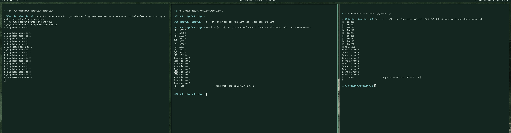
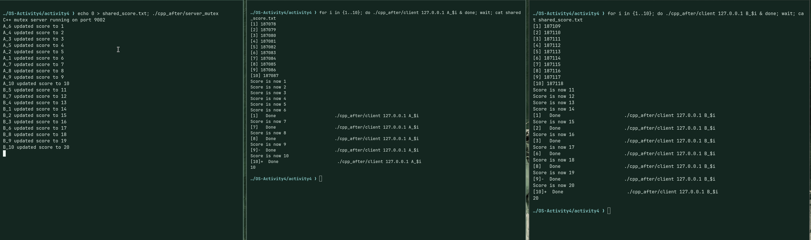
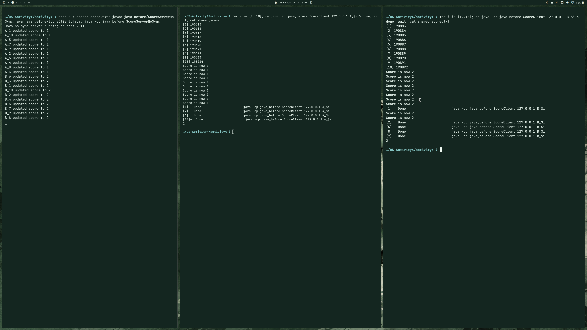
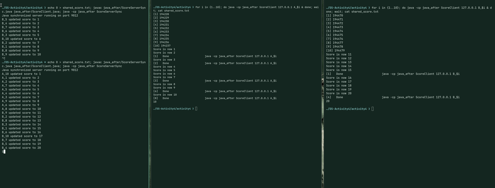

# Class Activity 4 — Shared File API

- **Student Name:** Phoung Sovannara
- **Student ID:** e20230093
- **Partner Name:** none (I did this activity alone)
- **Partner Student ID:** none
- **Server Machine Owner:** Phoung Sovannara
- **Server IP Address:** 127.0.0.1 (localhost)

I had no partner, so I ran the whole activity on my own Linux laptop with three terminals side by side: the left terminal is the **server**, the middle terminal plays **Student A** (clients `A_1` to `A_10`) and the right terminal plays **Student B** (clients `B_1` to `B_10`). Because server and clients are on the same machine, the clients connect to `127.0.0.1`. I started the A loop and then the B loop right after it. I used the course's suggested ports (9001, 9002, 9011, 9012). Java is not installed on the course server, which is another reason I used my laptop (g++ and OpenJDK).

---

## Task 1: C++ Before Mutex

- Expected score after 20 total client requests: 20
- Actual score: **2**
- What happened: the 10 A requests arrived together, so the server started 10 threads at almost the same time. Every thread read `0` from `shared_score.txt`, slept 200 ms, added 1 and wrote `1`, so 9 of the 10 updates were lost (every A client got `Score is now 1`). The 10 B requests then all read `1` and all wrote `2`. 18 of the 20 updates were lost. Even the server's printed lines were mixed (`A_3A_4 updated score to updated score to 11`), because two threads wrote to the terminal at the same time.

---

## Task 2: C++ After Mutex

- Expected score after 20 total client requests: 20
- Actual score: **20**
- What changed after adding mutex: the server log goes up exactly one step at a time, 1, 2, 3 … 20, and every client got a different score. `std::lock_guard` makes the threads take turns: only one thread can read, add and write the file at a time, so no update is lost. The cost is time: the 20 requests now take about 20 × 200 ms = 4 seconds instead of finishing almost at once.

---

## Task 3: Java Before Synchronized

- Expected score after 20 total client requests: 20
- Actual score: **2**
- What happened: the same race as in C++. Each client gets a new server thread, the A threads all read `0` and wrote `1` (all A clients got `Score is now 1`), then the B threads all read `1` and wrote `2`. Using Java instead of C++ does not change anything: without synchronization the read-modify-write of the file is not protected.

---

## Task 4: Java After Synchronized

- Expected score after 20 total client requests: 20
- Actual score: **20**
- What changed after adding synchronized: `updateScore` is now a `synchronized` method, so only one thread can be inside it at a time. The server log shows A_10, A_1, A_2 … in a random order, but the score still goes up by exactly one each time, from 1 to 20. (Higher in the server terminal there is an earlier test run that I stopped with Ctrl+C before running the final test.)

---

## Questions

1. **Why should clients send requests to the server instead of writing the file directly?**
   If every client wrote the file itself, many separate programs (even on different machines) would change the same file, and nothing could coordinate them. With a server, only one program touches `shared_score.txt`. The server is the single place where the rule "one update at a time" can be enforced, and the clients only need to send a request and read the reply. The server can also check the requests and hide how the data is stored.

2. **Why does the server still have a race condition before mutex or synchronized?**
   The server creates a new thread for every client, and all these threads run at the same time inside one process. Each update is three steps: read the score, add 1, write it back (with a 200 ms sleep in between). When two threads read the same old value before either one writes, both write the same new value and one update is lost. A single server program is not enough: its threads still share the file.

3. **In the C++ fixed version, what does `std::lock_guard<std::mutex>` protect?**
   It protects the whole body of `update_score()`: reading the file, the sleep, adding 1, writing the file and printing the message. `lock_guard` locks `file_mutex` when it is created and unlocks it automatically when the function returns (even if an error happens). Only the file update is locked; reading the request from the socket and sending the reply still run in parallel.

4. **In the Java fixed version, what does `synchronized` protect?**
   `synchronized` on the static method `updateScore` makes every thread lock the `ScoreServerSync` class object before it enters the method. So the whole method (read file, sleep, add 1, write file, print) can be run by only one thread at a time, and the others wait. `handleClient` is not synchronized, so connections are still accepted and answered in parallel.

5. **Why is the final score expected to be 20 when Student A sends 10 requests and Student B sends 10 requests?**
   Each request is one `ADD`, and each correct update adds exactly 1 to the score. The file starts at 0, so 10 + 10 = 20 requests must give 20 if no update is lost. Any number below 20 shows how many updates were overwritten by the race condition (in my unsafe runs, 18).

6. **What could happen if two separate servers update the same file at the same time?**
   The mutex and `synchronized` only work inside one process: the threads of server 1 and the threads of server 2 do not share the same lock. So the two servers could again read the same value and overwrite each other's updates, and the score would be wrong again. The file could even be half-written by one server while the other reads it. To fix this, there must be only one server, or the servers need a lock that works between processes (for example a file lock with `flock`, or a database that handles the locking).

---

## Reflection

C++ and Java solve the problem the same way, but with different tools. In C++ I create a `std::mutex` object myself and lock it with `std::lock_guard`, which unlocks it automatically at the end of the function. In Java I only add the keyword `synchronized` to the method, and the JVM locks and unlocks the class's built-in lock for me. The Java version is shorter and harder to forget to unlock; the C++ version is more explicit and lets me lock only the exact part I need. In both languages the unsafe server lost 18 of 20 updates, and the protected server gave exactly 20 every time. This activity taught me that putting a server in front of a shared file is not enough: as soon as the server uses threads, the shared resource must still be protected by a lock, and the lock must cover the whole read-modify-write. It also showed the price: the locked server is slower, because the requests wait for each other.
