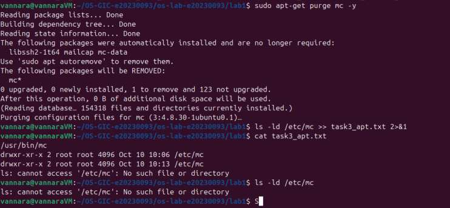
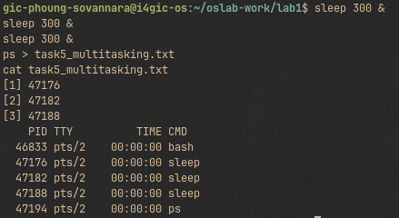
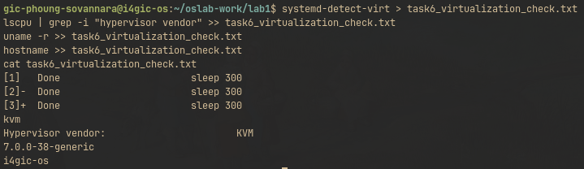

# OS Lab 1 Submission

Copy this template to `os-lab-YOUR_ID/lab1/README.md` in your own repository. Follow [the instructions](lab1-instruction.md). Your prediction and checkpoint answers are already saved by `oslab`; do not copy them here.

- **Student Name:** Phoung Sovannara
- **Student ID:** e20230093
- **Ubuntu username on the server:** gic-phoung-sovannara
- **My values** (`oslab values lab1`): file1 = lemon, file2 = maple, count = 3

---

## Task 1: Operating System Identification

Briefly describe what you observed about your OS and kernel. Which number is the kernel version, and which is the distribution version?

```text
Linux i4gic-os 7.0.0-38-generic #38-Ubuntu SMP PREEMPT_DYNAMIC Fri Sep  4 09:10:14 UTC 2026 x86_64 GNU/Linux
Distributor ID: Ubuntu
Description:    Ubuntu 26.04.1 LTS
Release:        26.04
Codename:       resolute
```

* **Kernel version:** `7.0.0-38-generic` (identified from `uname -a` and `uname -r`)
* **Distribution version:** `Ubuntu 26.04.1 LTS` (Release `26.04`, identified from `lsb_release -a`)

The Linux kernel acts as the core of the operating system managing the hardware, while the Ubuntu distribution bundles the kernel together with the GNU tools, package manager (APT), libraries, and system utilities.

---

## Task 2: Essential Linux File and Directory Commands

Briefly describe your experience creating, copying, renaming and deleting files. What did the last `ls` show?

In `task2_files`:
1. Created `lemon.txt` and `maple.txt` using `touch`.
2. Wrote content into each file using `echo ... > FILE.txt`.
3. Created a duplicate `lemon_copy.txt` using `cp`.
4. Renamed `maple.txt` to `maple_renamed.txt` using `mv`.
5. Deleted the copy `lemon_copy.txt` using `rm`.

The last `ls` showed the two final files:
* `lemon.txt`
* `maple_renamed.txt`

The copy `lemon_copy.txt` was removed and the original `maple.txt` was cleanly renamed without duplicate copies left behind.

---

## Task 3: Package Management Using APT

Explain the difference you observed between `remove` and `purge`.

* **`sudo apt-get remove mc`:** Uninstalls the program binaries (the executable `/usr/bin/mc` was deleted), but **preserves** configuration files and directories on the system. The directory `/etc/mc` remained intact (`drwxr-xr-x 2 root root ... /etc/mc`).
* **`sudo apt-get purge mc`:** Uninstalls the program **and completely deletes** all associated configuration files and directories. Inspecting `/etc/mc` after purge resulted in `ls: cannot access '/etc/mc': No such file or directory`.

<!-- SCREENSHOT REQUIREMENT: your terminal after the purge, showing `ls -ld /etc/mc` and your prompt. -->


---

## Task 4: Programs vs Processes

Briefly describe how you ran a background process and found it in the process list. What is the difference between a program and a process? What did you see before, during and after?

* **Difference:** A **program** is a static executable binary stored permanently on the storage disk (`/usr/bin/sleep`). A **process** is an active, dynamic instance of that program loaded into RAM and currently executing with its own Process ID (PID).
* **Execution:** Appending `&` (`sleep 30 &`) ran the command as a background job and immediately returned the shell prompt.
* **Observation:**
  * **Before:** `ps` showed only `bash` and `ps`.
  * **During:** `ps` showed the running process with PID `47093` alongside `bash`.
  * **After 30s:** The process finished and disappeared from `ps`, but `which sleep` still located `/usr/bin/sleep` on disk, proving the program remains intact even when its process terminates.

---

## Task 5: Multitasking

Briefly describe the multitasking you saw. How many `sleep` lines did `ps` show? What does that show about the system, and what does it **not** show about how the processor is shared?

* Ran `sleep 300 &` three times (count = 3).
* Running `ps` displayed **3 separate lines** containing `sleep`, each assigned a distinct Process ID (`47176`, `47182`, `47188`).
* **What it shows:** The operating system supports multitasking by maintaining and scheduling multiple independent processes concurrently in memory.
* **What it does NOT show:** Because `sleep` simply pauses without executing CPU calculations, it consumes virtually 0% CPU cycles. Therefore, it does not demonstrate how the CPU scheduler actively divides execution time slices among compute-intensive processes.

<!-- SCREENSHOT REQUIREMENT: your terminal with the `ps` result and your prompt. -->


---

## Task 6: Virtualization and Hypervisor Detection

State whether your system is running on a virtual machine or physical hardware, based on the command outputs.

* `systemd-detect-virt` returned `kvm`.
* `lscpu | grep -i "hypervisor vendor"` returned `Hypervisor vendor: KVM`.
* `uname -r` showed kernel `7.0.0-38-generic`.
* `hostname` showed `i4gic-os`.

**Conclusion:** The course server is running inside a **virtual machine** hosted on a **KVM (Kernel-based Virtual Machine)** hypervisor, rather than directly on bare-metal physical hardware.

<!-- SCREENSHOT REQUIREMENT: your terminal with the output of the four commands and your prompt. -->


---

## My Prediction: Confirmed or Corrected

For each prediction answer (`oslab predict lab1`), write **confirmed** or **corrected** and what you saw that shows it. You test the third answer (`apt-get remove`) in Task 3.

1. **Prediction 1 (Background sleep processes):** **Confirmed.** Starting background instances showed multiple separate `sleep` lines in `ps`, each with a unique PID.
2. **Prediction 2 (`which sleep` path existence after completion):** **Confirmed.** After the process exited, `which sleep` still printed `/usr/bin/sleep` because the program remains stored on the disk.
3. **Prediction 3 (`apt-get remove` configuration behavior):** **Confirmed.** `apt-get remove` kept `/etc/mc` on the disk, and only `apt-get purge` removed the configuration directory.

---

## Plus / Challenge (only if you did them)

* In `top`, the `Tasks:` count is higher than the processes we started because the system runs background system daemons, kernel threads, and services started by other users and systemd.
* `nproc` prints the total available CPU cores that the scheduler can distribute processes across.

## AI Note (optional)

Used AI assistance to clarify the distinction between `remove` vs `purge` in APT package management and how KVM virtualization exposes hypervisor flags to `lscpu`.
